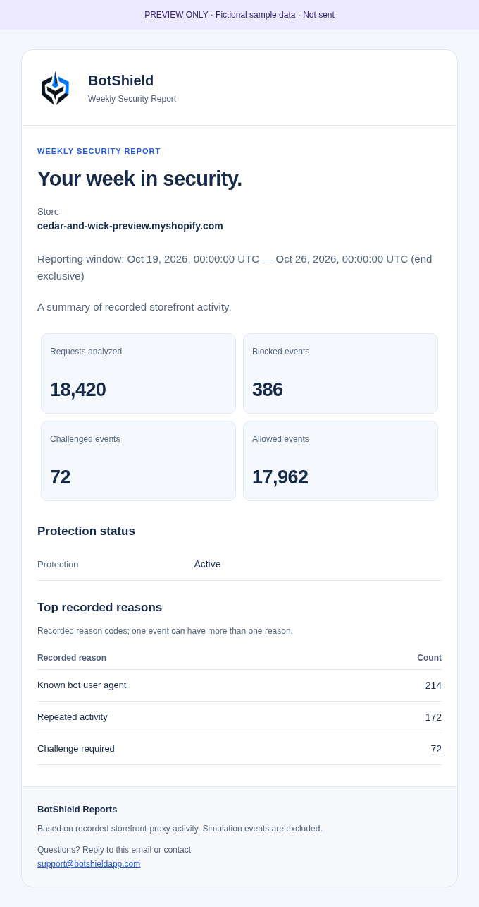
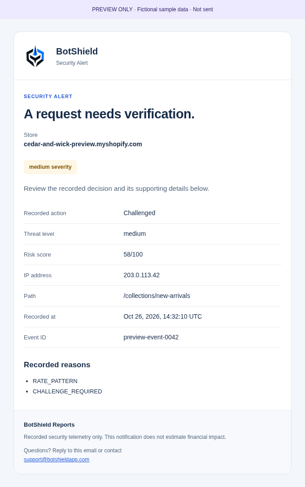
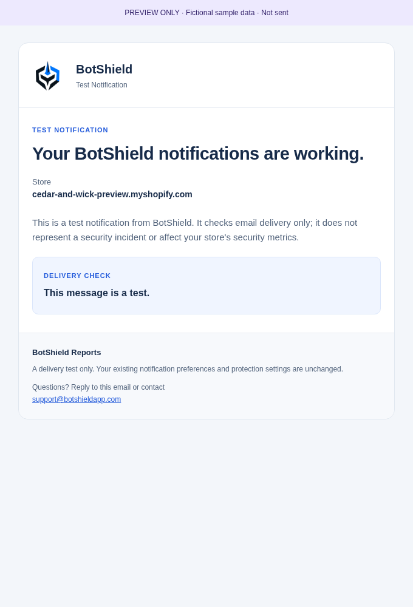

# BotShield merchant email design review

**Preview only.** All sample stores, dates, counts, IP addresses and events are fictional. No messages were sent. The production app UI and verified sender configuration are unchanged.

| Template | HTML | Plain text | Desktop | 320px mobile | Dark browser preview | Images blocked |
| --- | --- | --- | --- | --- | --- | --- |
| Weekly Security Report | [HTML](weekly.html) | [Text](weekly.txt) | [Image](weekly-desktop.png) | [Image](weekly-mobile.png) | [Image](weekly-dark.png) | [Image](weekly-images-blocked.png) |
| Security Alert | [HTML](alert.html) | [Text](alert.txt) | [Image](alert-desktop.png) | [Image](alert-mobile.png) | [Image](alert-dark.png) | [Image](alert-images-blocked.png) |
| Test Notification | [HTML](test.html) | [Text](test.txt) | [Image](test-desktop.png) | [Image](test-mobile.png) | [Image](test-dark.png) | [Image](test-images-blocked.png) |

The [gallery](index.html) can also be opened locally. GitHub may display HTML source instead of rendering email HTML; use the screenshot links for immediate review.

## What changes

- One shared email-only table layout, official logo, navy/blue palette, inline styling, footer and plain-text composition.
- Flagship weekly report: passed-in totals, actual reporting window in UTC (end exclusive, matching the existing database query), available protection status, and recorded reason counts. Uses the existing UI reason-label formatter. Missing fields are omitted; known zero activity is displayed as zero. No inferred trends, financial claims, fabricated periods or new calculations.
- Actual alerts: decision-accurate headline, actual severity treatment, optional risk score, IP/path, timestamp, event ID and recorded reasons. A challenge is never described as a block.
- Separate test-only body and plain text: no invented telemetry, no call to the real incident renderer, and no event creation. Existing API code and delivery-status metadata updates remain unchanged.
- Established subjects are preserved, including the legacy `[BotShield] TEST incident on …` subject. Its body is now unmistakably a Test Notification.

Scheduled and manually requested weekly reports still use the same `sendWeeklySecurityReportEmail` function and therefore the same official design. Alert eligibility, cooldowns, schedules, report calculations, recipients, notification preferences, Resend transport, sender/Reply-To and delivery result contracts are untouched. There are no new dependencies or production environment updates.

## Links and image verification

The image is the existing `public/botshield-official-logo-transparent.png`, unchanged. Its public HTTPS URL returned HTTP 200 and the downloaded bytes matched the repository SHA-256:

`https://botshield-backend.onrender.com/botshield-official-logo-transparent.png`

`ff132a41a95bc4ebe9ceb4e3342780a62f40707ce7acc32f4407e8db36ddeac1`

The always-visible BotShield wordmark and image alt text provide a readable fallback when images are blocked. The white logo tile protects the original artwork in the explicit dark-mode styles; no recoloring or filters are applied.

Dashboard CTAs use the existing `SHOPIFY_APP_HANDLE` and authenticated store domain, following the existing Shopify Admin `/store/{store}/apps/{handle}/app` Overview convention. Missing/invalid configuration omits both HTML and plain-text CTAs. No guessed literal production handle, localhost link, marketing substitute or Render login link is used. Fictional preview stores have no verified app installation, so these preview artifacts intentionally omit the CTA. Production handle/destination confirmation and an authenticated click test remain part of pre-release review; the public routing detail was requested from the owner. No environment setting has been changed.

## Compatibility and validation

Essential styles are inline, with table-based fluid layout, an Outlook conditional fixed-width wrapper, system fonts, explicit image dimensions and useful plain-text alternatives. The only embedded CSS is optional dark-mode enhancement; the light baseline does not depend on it. There is no email JavaScript, animation, external stylesheet or web font. Rounded corners gracefully become square where unsupported.

Browser checks cover desktop/mobile light/dark, blocked images, long names/paths, large numbers, zero activity, missing values, and high/medium/low/unknown severity. [Machine-readable results](browser-checks.json) record the checks. Axe checks exclude web-page landmark rules (`region`, `landmark-one-main`), which are not applicable to these transactional-email tables; the remaining checks include contrast, image names and table semantics.

**Chromium is not an email client.** Actual Gmail web/mobile, Outlook (especially Windows Word rendering), Apple Mail and proprietary forced dark-mode transformations have not been tested for these new templates. No live email was sent. Those inbox checks need explicit approval and are required before a production release can be claimed client-verified.

## Reproduce locally

Generate the three HTML and plain-text artifacts (this script cannot send email):

```text
node scripts/preview-merchant-emails.mjs
```

With existing external browser tooling available, configure `PLAYWRIGHT_MODULE`, `AXE_MODULE` and optionally `CHROMIUM_PATH`, then run:

```text
node scripts/test-merchant-email-previews.mjs
```

The browser script starts its own loopback-only server, uses the unchanged local official image for rendering, writes the screenshots/results here, and shuts down its server. It never imports the delivery helper, credentials, application database or authenticated merchant session.

Run focused template and mocked transport tests:

```text
node --test tests/merchant-email-templates.test.mjs tests/email-sender.test.mjs
```

## Desktop design previews

### Weekly Security Report



### Security Alert



### Test Notification



## Recorded checks for this PR

- **476 automated tests passed**, including the existing mocked sender/Reply-To tests and 12 focused template tests.
- Existing style SSR and Overview hydration probes passed.
- Production build and TypeScript passed.
- Targeted lint for all changed/new source, tests and preview scripts passed. Full repository lint retains the existing **190 errors / six warnings**, with no new targeted failures; no unrelated cleanup was performed.
- **26 browser checks passed** for light/dark, 320px/desktop, blocked images, long content/large counts, zero/missing data, and severity variants. Email-appropriate Axe checks found zero violations.
- The full diff leaves `email.server.js`, notification routes, schedules/cooldowns, report calculations, detection, sender/Reply-To configuration, Shopify configuration/extensions, database and production UI unchanged.

No merge, deployment, live merchant email, production environment edit or Shopify app version has been performed for this PR.
