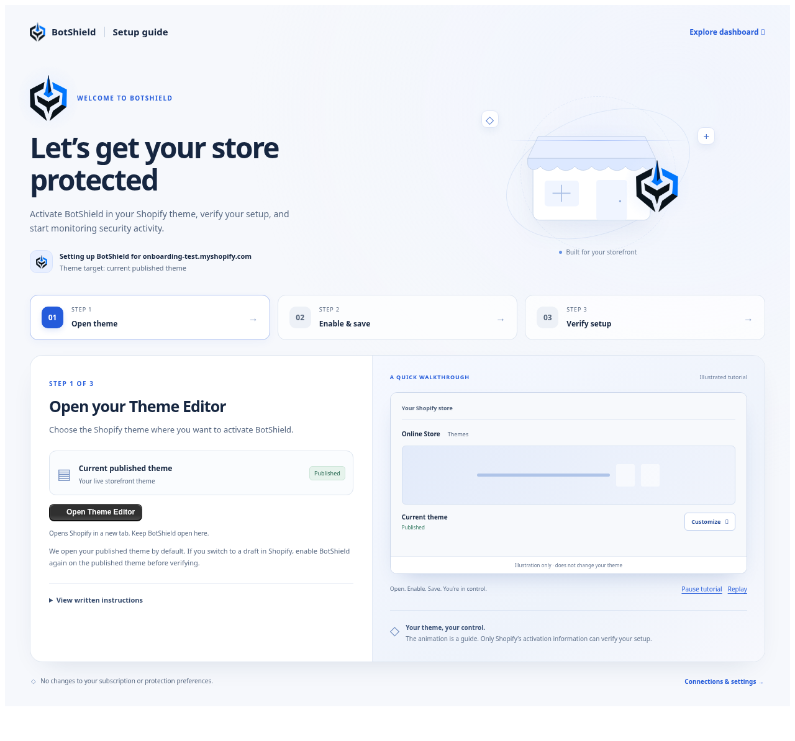

# BotShield merchant onboarding — implementation and release review

**Draft PR #10 — final production-readiness review; no release performed.** Published-theme verification uses Shopify's scope-free App Bridge App API. There is no additional permission prompt, independent theme-ID requirement, or theme Admin API lookup. The owner confirmed successful real testing on `sarahs-candles.myshopify.com`, including the published Horizon theme, the loading-state fix, and the Theme Editor exemption. Cloud automation independently checks the implementation; the owner's observations are not represented as cloud-run Shopify tests.

## What changed

The authenticated embedded route **`/app/onboarding`** presents one guide with three steps: open the Theme Editor, enable and save the embed, and verify activation. It uses the existing embedded provider, React Router, query-preserving navigation, app frame and action buttons. No frontend dependency was added.

The welcome illustration combines an original lightweight SVG storefront with BotShield’s existing official transparent logo, ambient nodes and a scanning line. Cards enter with restrained staggered motion. The ten-second tutorial illustrates the Theme Editor entry, App embeds panel, toggle, and Save action. Pause also pauses the hero's ambient motion; replay restarts the tutorial. Written instructions are always available. Reduced motion disables decorative animations and shows static instructions. The verified completion screen reveals the official logo with a separate animated verification checkmark, adds a small particle burst, and offers immediate Overview navigation, a pause action, and instruction review. Normal automatic continuation takes 2.5 seconds. Intentional visits by already-configured merchants stay open for review.

Overview has one setup reminder and routes its incomplete connection actions to the guide. Settings → Connections → Theme activation → Setup guide reopens it. Existing Protection controls can still open Shopify's editor directly. No dashboard, pricing, policy, detection, reporting, webhook or database schema logic changed.

## Official BotShield branding

The onboarding reuses **`public/botshield-official-logo-transparent.png`** through the existing `publicInfo.logoUrl`, the same official asset used by the public information pages. The storefront theme extension also contains this angular blue-and-black mark. It matches the owner’s supplied logo; the older robot illustration in `botshield-logo-transparent.png` is not used.

The existing official PNG has genuine RGBA transparency, native dimensions **208 × 256**, and is reused byte-for-byte. No logo was generated, redrawn, recolored, cropped, background-removed again or replaced. It appears in the header, prominent welcome lockup, setup profile badge, storefront illustration, animated Theme Editor tutorial and success celebration. The success checkmark is a separate status badge, not an alteration of the logo.

CSS preserves the image’s intrinsic proportions with `height: auto` / `object-fit: contain`. Entrance motion uses a small translation and fade on wrappers; soft aura motion runs behind the logo. The artwork has no color filters or blend effects. Reduced-motion and pause controls cover the decorative effects. The largest logo is 68 CSS pixels wide, so the native artwork supplies enough pixels at **3× device pixel ratio** without upscaling. Browser checks verify image loading, the shared official URL, native dimensions, unchanged proportions, no filters/blending and device-pixel coverage at desktop and mobile sizes.

The official-brand update touches presentation, browser assertions and evidence only. Shopify activation parsing, authentication, billing, guide persistence, and automatic Overview navigation are unchanged. The tutorial recording and screenshots have been refreshed to show the official mark.

## Technical correction: scope-free published-theme verification

The earlier implementation incorrectly inferred from the installed TypeScript placement types that an independent published-theme lookup was necessary. Shopify's documented **App API contract** says `shopify.app.extensions()` reports theme app extension activation information for the **published theme only**, without additional access scopes. The scope-bearing theme query was unnecessary and has been removed, along with its `published-theme.server.js` module, placement-ID matching helper and permission-limitation UI. No `read_themes` permission is added, requested or required.

The client calls the existing App Bridge API and finds the `theme_app_extension` activation with handle `botshield-embed`. It uses these distinct states:

| Shopify response | BotShield interpretation | Completion |
| --- | --- | --- |
| `active` | Embed enabled on the published theme | Verified |
| `available` | Embed exists but is not activated | Incomplete |
| `unavailable` | Embed is not currently usable (`unusable` connection state) | Incomplete |
| No matching embed | Missing embed | Incomplete |
| Rejected/timed-out call, absent API, malformed or unknown status | Unable to verify (`unavailable` connection state) | Unverified |

Theme placement IDs and theme-name personalization are not needed. The browser fixtures intentionally provide **no theme IDs, theme access flags or theme names**. They verify that `active` completes onboarding and automatically opens Overview without a permission prompt or Admin GraphQL request. They also verify that an unusable embed and a failed API call produce different presentations and cannot produce success.

The animated switch, Open Theme Editor click and per-shop guide acknowledgment remain separate from technical activation. None can verify setup. Draft-theme changes do not alter the published-only API's result until the published theme's activation actually changes; the browser tests no longer invent draft-theme placements in a published-only API response.

`GET /api/onboarding` now returns only authenticated shop identity and guide acknowledgment. It does not use the Admin API or query themes. Metadata loading and App Bridge reading start concurrently; metadata failure cannot substitute for activation proof. Current results have lifecycle guards and bounded timeouts. Returning from the editor coalesces focus/visibility events into one check, with one fresh follow-up if an earlier check was still running. This also covers App Bridge becoming ready after the initial attempt. There is no periodic polling.

Official references supplied for this correction:

- https://shopify.dev/docs/api/app-home/latest/apis/authentication-and-data/app-api
- https://shopify.dev/docs/apps/build/online-store/theme-app-extensions/configuration

Direct retrieval of these pages returned HTTP 403 in this environment; no independent live documentation fetch is claimed. The implementation follows the documented published-only contract specified in the review request.

## Editor link and merchant profile

The existing helper targets `https://{authenticated-shop}/admin/themes/current/editor?context=apps&activateAppId={app-api-key}/botshield-embed`. It now rejects unsafe shop domains and handles, and encodes parameter values. The app key is public configuration; no access token goes into the link. The editor opens in a new tab with `noopener,noreferrer`, leaving the embedded guide available for the merchant's return.

The guide defaults to the current published theme. No theme-list permission or additional permission prompt is introduced. Shopify's editor remains the place to select a different theme, with a reminder that draft activation does not verify the published storefront.

The profile shows the authenticated `.myshopify.com` identifier and “Theme target: current published theme.” Theme-name personalization is omitted. It does not invent a store name or request personal details. The actual `body`-target embed has an empty settings schema: the guide explains that it has no Theme Editor settings, applies where the storefront theme renders the embed, and does not add an embed to checkout. It explains activation, deactivation and saving without changing legal content.

## Routing, persistence and failure handling

- The parent route retains Shopify authentication. OAuth, billing returns, webhooks and public routes are not intercepted. Billing return skips activation/profile requests entirely.
- Only an initial `/app` visit with an unacknowledged guide and a confirmed inactive/missing/unusable embed is offered onboarding. Explicit legacy views and charge-return parameters are not redirected.
- A small initial loading state prevents flashing Overview before this decision. Subsequent background checks do not unmount the dashboard.
- Per-shop guide acknowledgment uses the existing `AppSetting` unique `(shop, key)` record, key `onboarding.guideAcknowledged.v1`, value `acknowledged`. It records visiting the guide or already-enabled embed status, **not technical completion**. No migration is needed. The authenticated session supplies the shop on reads and writes; request bodies cannot choose a shop.
- A failed acknowledgment save displays a retry and preserves dashboard access for the current app session. A later session may offer the guide again until saving succeeds.
- The selected instruction step is an optional per-shop `sessionStorage` convenience; blocked storage does not prevent setup. No stored browser value verifies activation.
- The provider is keyed to the authenticated merchant shop. It validates profile responses against that shop and cancels stale lifecycle results.
- Initial load, route entry, window focus, visibility return and manual checks share one in-flight request. Every check reads Shopify’s current published-theme activation status. Return events are coalesced; one follow-up reads a fresh result if the return happened during an older in-flight check. There is no periodic polling. Profile and App Bridge calls have bounded timeouts.
- Starting any new check immediately removes current success. Failed verification retains a separately labeled historical status without using it for completion or a delayed redirect.
- Success depends only on the matching embed’s `active` status in Shopify’s published-theme API response, independent of subscription, protection preferences or recorded traffic. Analytics can remain empty after valid activation.
- Exiting the guide or disabling the embed later does not lock merchants out of Overview. Returning users can always reopen the guide.

## Evidence

All screenshots and the recording below use **synthetic local sessions and mocked Shopify activation responses**, never actual merchant data. The built application is rendered with the real downloaded Polaris runtime. The local harness replaces only its in-memory parent loader; deployed authentication source is not bypassed. Screenshots hide Shopify's host-consumed navigation element to represent the content area. The simulated iframe exercise adjusts `frame-ancestors` only in the browser's intercepted test response to permit a localhost parent; production CSP is unchanged. It is not a live Shopify Admin test.

Baseline captures come from an archive of `ac2e90ddd84b2265c010bef82aa32aeaaa1c1d83`, built separately with the same dependencies.

| View | Evidence |
| --- | --- |
| Before: Overview / Connections | [Overview](screenshots/merchant-onboarding/before-overview.png), [Connections](screenshots/merchant-onboarding/before-connections.png) |
| Welcome / Theme Editor | [Desktop](screenshots/merchant-onboarding/welcome-desktop.png) |
| Enable and save | [Desktop](screenshots/merchant-onboarding/enable-and-save-desktop.png), [mobile](screenshots/merchant-onboarding/enable-and-save-mobile.png) |
| Verification | [Inactive](screenshots/merchant-onboarding/verify-inactive-desktop.png), [checking](screenshots/merchant-onboarding/verification-checking.png), [unavailable](screenshots/merchant-onboarding/verify-unavailable-desktop.png) |
| Unusable embed / scope-free completion | [Unusable](screenshots/merchant-onboarding/verify-unusable-desktop.png), [scope-free success](screenshots/merchant-onboarding/scope-free-activation-success.png) |
| Completion / destination | [Success](screenshots/merchant-onboarding/verified-success.png), [Overview](screenshots/merchant-onboarding/overview-after-onboarding.png) |
| Required viewport widths, reduced motion | [1440](screenshots/merchant-onboarding/onboarding-1440-reduced-motion.png), [1280](screenshots/merchant-onboarding/onboarding-1280-reduced-motion.png), [1024](screenshots/merchant-onboarding/onboarding-1024-reduced-motion.png), [768](screenshots/merchant-onboarding/onboarding-768-reduced-motion.png), [390](screenshots/merchant-onboarding/onboarding-390-reduced-motion.png), [360](screenshots/merchant-onboarding/onboarding-360-reduced-motion.png) |
| Simulated iframe / mobile verification | [Content area](screenshots/merchant-onboarding/simulated-shopify-admin-content-area.png), [mobile verification](screenshots/merchant-onboarding/verify-activation-mobile.png) |
| Official artwork at high density | [Desktop at 3×](screenshots/merchant-onboarding/official-brand-desktop-3x.png), [mobile at 3×](screenshots/merchant-onboarding/official-brand-mobile-3x.png), [success at 3×](screenshots/merchant-onboarding/official-brand-success-3x.png) |
| Tutorial motion | [10-second recording](screenshots/merchant-onboarding/tutorial-motion.mp4) (silent, sampled from actual rendered frames) |



## Checks run

- `npm run test:mvp`: **453 tests passed**, including the 426-test existing baseline and 27 new onboarding checks; both existing style and hydration SSR probes passed.
- `npm run typecheck`: passed.
- `npm run build`: passed. No added application dependencies. The onboarding route bundle is approximately 5 KB gzipped and its scoped stylesheet approximately 6 KB gzipped in this build.
- `npx vite-node app/dev/onboarding-ssr-probe.mjs`: actual onboarding SSR/hydration passed with a synthetic session and reduced motion. Existing React Router SSR development warnings remain; no hydration mismatch was reported by the probe.
- Targeted lint for all new modules, route changes, browser script and focused tests: passed. The two large pre-existing admin files retain their original diagnostics (87 errors / 3 warnings in the index route, 21 errors / 2 warnings in the admin component). Full lint reports **190 errors and 6 warnings**, down from 192 / 6 because the touched parent route now correctly places its two existing `process` directives. Repository-wide lint is not passing.
- Local PostgreSQL: acknowledgment persisted through independent Prisma clients, remained isolated between two synthetic shops, and was idempotent. Only those temporary test keys were cleaned up. No production database or migration was used.
- All **twelve browser acceptance scenarios passed**. Browser checks cover first-visit routing, editor URL, instructions, keyboard focus, pause/replay, manual checks, missing/inactive/unavailable statuses, unusable embed status, scope-free completion, in-flight-return and App Bridge readiness checks, current success invalidation, request deduplication, Overview continuation, intentional review, Settings entry, back/refresh, exit after failed save, all requested viewport widths, reduced motion, and official-logo fidelity at 3× device pixel ratio.
- The simulated Shopify Admin content-frame layout check passed using a local-only test CSP adjustment. A real Shopify frame remains unverified.
- Axe WCAG 2 A/AA and 2.1 AA: zero reported violations across all three steps at 1280 and 360 widths after fixing observed contrast issues. This automated scan is not a complete accessibility certification.
- Real local server with synthetic credentials: `/health` returned 200 with the local database connected; public `/data-use`, `/data-retention`, `/privacy`, `/terms`, `/data-deletion` returned 200. Unauthenticated `/app/onboarding`, existing `/app/settings` and `/api/onboarding` all returned Shopify's existing 410 handling response with these fake credentials. This confirms protected routes did not become public; it does not prove authenticated Shopify login works.
- OAuth, billing, webhooks/HMAC, protection, analytics and related regression tests passed as part of the full suite. Their production behavior has not been retested in a real merchant session.

## Repeatable local checks

Use Node 24.17.0 and the documented local PostgreSQL setup. Do not use Render database credentials.

```sh
npm run test:mvp
npm run typecheck
npm run build
npx vite-node app/dev/onboarding-ssr-probe.mjs
npx eslint app/components/onboarding app/lib/onboarding.js app/lib/onboarding.server.js app/routes/api.onboarding.jsx app/routes/app.onboarding.jsx app/lib/theme-extension-status.js app/lib/theme-extension-status.client.js app/routes/app.jsx app/dev/onboarding-ssr-probe.mjs scripts/test-onboarding-browser.mjs tests/onboarding.test.mjs scripts/dev-onboarding-preview.mjs
```

For the browser acceptance runner, use a local synthetic-session preview. The guarded `scripts/dev-onboarding-preview.mjs` harness replaces only the built app parent loader in memory and binds to loopback. It refuses production mode, requires explicit opt-in and refuses non-local databases. Browser tooling was installed outside the repository, so it does not alter production dependencies. Configure `PLAYWRIGHT_MODULE`, `CHROMIUM_PATH`, `AXE_MODULE` and `BOTSHIELD_POLARIS_SCRIPT` for your tooling paths and set `BOTSHIELD_ONBOARDING_BASE_URL` to that localhost preview. `BOTSHIELD_SCREENSHOTS` selects the evidence directory. Then run:

```sh
node scripts/test-onboarding-browser.mjs
```

Start the separate local preview after building:

```sh
BOTSHIELD_SYNTHETIC_PREVIEW=1 node scripts/dev-onboarding-preview.mjs
```

Browser tooling can be installed outside the checkout, for example `npm install --prefix /tmp/botshield-browser-tools --no-save playwright-core @axe-core/playwright`. Set `PLAYWRIGHT_MODULE=/tmp/botshield-browser-tools/node_modules/playwright-core/index.mjs` and `AXE_MODULE=/tmp/botshield-browser-tools/node_modules/@axe-core/playwright/dist/index.mjs`. Use an installed Chromium via `CHROMIUM_PATH` and a locally downloaded copy of Shopify's `https://cdn.shopify.com/shopifycloud/polaris.js` via `BOTSHIELD_POLARIS_SCRIPT`. No browser package was added to the app manifest or lockfile.

The runner refuses a non-local base URL. It mocks activation/profile/backend responses and must not be used to claim real Shopify verification.

## Sarah's Candles development-store smoke test — owner-confirmed results

The owner confirmed the core onboarding, activation, completion/refresh, guide reopening, responsive branding, Overview 4/4 active modules, and editor-preview regression checks on `sarahs-candles.myshopify.com`. The owner observed 20 storefront events, four blocked events and zero challenged events. These counts do not independently prove every enforcement scenario. The following is the full smoke-test checklist; unreported cases are not claimed as real-session passes. Keep development configuration and credentials isolated from production.

1. Use the existing app permissions. There must be no extra Shopify permission prompt for theme verification. The production theme bundle changes require a Shopify extension release, with production app configuration and scopes unchanged.
2. Run `shopify app dev --config shopify.app.botshield-dev.toml --store sarahs-candles.myshopify.com` only in the separate Windows Dev checkout, after confirming that file identifies BotShield Dev. Open the authenticated embedded app through Shopify Admin. Check subscription approval and any reauthentication still use the existing flows.
3. For initial-visit behavior, use a fresh development shop or clear only that development shop's guide acknowledgment key in its development database. Never clear merchant settings or production data. With the published embed disabled, opening `/app` should offer `/app/onboarding`. Loading should be stable without an Overview flash.
4. Verify the displayed shop identifier matches Shopify and the theme target says current published theme; a theme name is intentionally omitted. Activate Open Theme Editor: it must open that shop's current published theme, App embeds context, with the BotShield embed selected. Check that the embedded guide remains open in its tab.
5. Find BotShield under App embeds. Turn it on but do not save; return and verify that opening the editor alone is insufficient. Save, return to BotShield, and check the refreshed status. No tutorial control can change the actual embed status.
6. With App Bridge reporting `active` for `botshield-embed`, observe the completion animation and immediate Go to Overview control. Check Stay on this page, then automatic continuation, and query-parameter preservation. Confirm the normal `/app` Overview loads.
7. Reload Overview and reopen the app in another staff session. Onboarding should not be forced again. Settings → Connections → Setup guide should open a reviewable guide and remain there for an already-active shop.
8. Disable and save the published embed. Return to Overview: dashboard access remains available and a setup reminder appears. Re-enable it and confirm the reminder disappears only after current verification.
9. Activate only an unpublished theme; it must not produce published-theme success. Switch published themes and recheck. Test an embed reported as `unavailable` and failed Shopify API calls separately; no stale success or redirect is allowed.
10. Test keyboard-only setup, written instructions, pause/replay, reduced motion and narrow Shopify Admin content widths. Confirm editor/new-tab behavior on desktop and mobile.
11. Open Overview, Protection, Analytics, Value, Fraud Orders and Settings. Confirm existing data and controls remain functional. Check billing status, session refresh and established webhook delivery monitoring without changing prices, secrets or endpoints. Do not run synthetic browser mocks against production.
12. Review screenshots and the real flow with the owner before approving merge or production release. Shopify App Store compliance approval has not been established by this work.

## Deployment after explicit approval

1. Review the corrected PR diff, finished screenshots and scope-free completion flow in Sarah’s Candles. Re-run checks after any further code changes. Obtain explicit owner approval before merging or deploying.
2. After owner approval, merge the reviewed PR into `main` using normal GitHub checks. Do not bypass checks or force-push. Render's existing GitHub auto-deploy should run its unchanged build/start commands on the Starter service. No new environment variables, domain, service or database migration are needed for the implementation in this PR.
3. Keep Shopify app identity, configuration and permissions unchanged. Render deploys the web backend only. Separately publish the updated production theme extension using the explicit production configuration, after verifying backend health. Follow the staged PowerShell commands below; never publish from a dirty Dev checkout.
4. Inspect Render's build log and service Live status. Request `/health` at `https://botshield-backend.onrender.com/health` and require two HTTP 200 responses with `ok: true`, `database: "connected"`, and `deployCommit` matching the actual merge commit. A healthy old commit is not deployment confirmation.
5. Release and confirm the approved production Shopify app version, then repeat the authenticated smoke test on the approved release and inspect errors. Do not claim production success from build output or a mocked session.

## Rollback

If release verification fails, stop rollout and use Render's rollback to the last confirmed healthy deploy, or create a normal GitHub revert PR for this feature's merge commit and allow the approved GitHub deployment process to run. Do not reset or force-push `main`. Confirm the old commit via `/health` and check the embedded app. The harmless guide-acknowledgment rows can remain; the prior app ignores them. There is no schema migration to reverse.

## Changed-file inventory

- `app/components/onboarding/OnboardingPage.jsx`: guide steps, merchant context, review/completion/navigation and written instructions.
- `app/components/onboarding/OnboardingIllustrations.jsx`: official transparent logo reuse, original storefront SVG, verification checkmark and illustrative editor motion.
- `app/components/onboarding/ThemeActivationProvider.jsx`: shared current verification and profile lifecycle.
- `app/components/onboarding/OnboardingGate.jsx`: scoped initial-visit routing and loading.
- `app/components/onboarding/SetupReminder.jsx`: Overview setup entry.
- `app/styles/onboarding-premium.css`: isolated responsive, motion and reduced-motion styling.
- `app/lib/onboarding.js`, `app/lib/onboarding.server.js`: routing rules, bounded checks and authenticated per-shop acknowledgment. The former theme-query module was deleted.
- `app/lib/theme-extension-status.js`, `app/lib/theme-extension-status.client.js`: existing helper validation and scope-free published-theme activation parsing, including the distinct unusable state.
- `app/routes/app.onboarding.jsx`, `app/routes/api.onboarding.jsx`: embedded guide and authenticated metadata endpoints.
- `app/routes/app.jsx`, `app/routes/app._index.jsx`: shared provider, merchant isolation, initial gate and existing dashboard connection state integration.
- `app/components/admin/BotShieldAdminExperience.jsx`: Overview and Settings setup entry points.
- `tests/onboarding.test.mjs`, `tests/overview-store-health-refresh.test.mjs`, `tests/settings-phase2-closeout.test.mjs`: focused tests and revised navigation expectations.
- `app/dev/onboarding-ssr-probe.mjs`, `scripts/test-onboarding-browser.mjs`, `scripts/dev-onboarding-preview.mjs`: executable hydration, guarded local preview and browser acceptance checks.
- This report and `docs/screenshots/merchant-onboarding/`: review evidence and release instructions.

### Post–development-store test investigation

Merchant-reported real Shopify testing in Sarah's Candles passed the Theme Editor
link, save, activation verification, success animation, automatic Overview redirect,
refresh persistence, and Settings → Connections → Setup guide reopening. These are
merchant observations; the cloud checks below do not independently reproduce that
Shopify session.

**Overview flash:** Confirmed presentation bug. The dashboard initialized the embed
as unavailable/false and derived module health before `/api/settings`, `/api/status`,
and App Bridge verification completed. Navigation/focus verification also clears
activation while checking. Overview now explicitly displays “Checking protection
status” and “Checking protection modules…” until those inputs settle, including the
React effect that copies provider state. Module badges show Checking and the count
is withheld. Settled inactive, active, and degraded outcomes remain distinct; no
protection calculations or enforcement settings are changed. The SSR/hydration
probe covers unknown, inactive, and active views.

**Theme Editor challenge:** Confirmed missing editor exemption in the theme embed
bundle. The “Quick security check” string is implemented by
`extensions/botshield-theme-app-extension/assets/botshield.js`; it requests the
embed's configured app proxy and can render a challenge or redirect. The editor
preview was previously treated as an ordinary storefront visit. Both production
and Dev copies can contain this same script/text, so the reported appearance alone
cannot establish which installed app served the observed challenge. The checked-in
canonical embed uses `/apps/botshield/decision`; a Dev overlay must point to its
isolated Dev proxy. Do not infer origin from the visible BotShield brand.

The bundle now exits before storage access, demo timers, decision fetches, challenge
UI, or redirects when Shopify's `request.design_mode` Liquid signal or
`Shopify.designMode` is true. No URL parameter exemption, server-side bypass, scope,
configuration, database, or live-theme change is introduced. Ordinary storefront
requests retain the same detection and enforcement path. Executable bundle tests
cover both editor signals, normal visits, demo timers, and attempted query-string
opt-outs.

Before release, retest the updated Dev extension in Sarah's Candles. In the Theme
Editor preview frame's Network panel, inspect the actual loaded extension asset
URL (its extension identifier can be matched to the Dev app) and any
`/apps/botshield/decision` versus `/apps/botshield-dev/decision` requests. Capture only
non-sensitive paths/extension identifiers. This identifies which version is still
running if a challenge remains. An already installed production extension will
retain its old behavior until separately released; this draft does not update it.
Verify the updated Dev preview makes no Dev decision requests or challenge UI,
then verify an ordinary storefront visit still requests its protection decision.
Do not disable the production embed or modify production configuration to perform
this check.

Validation for this follow-up: 458/458 Node tests passed (five new executable
editor-preview regressions); existing style SSR and expanded Overview hydration
probes passed; onboarding SSR/hydration passed; production build and TypeScript
passed; `git diff --check` passed. Targeted ESLint on the three changed application
JS/JSX files still reports 108 errors and five warnings, exactly matching their
pre-change baseline (87 errors/three warnings in the dashboard route and 21
errors/two warnings in the admin component; storefront script clean). No new live
Shopify/browser session was run by the cloud agent for these fixes. The updated
Dev extension's editor exemption and ordinary storefront enforcement need merchant
retesting before release. Production configuration remains unchanged.


## Final review: production isolation and safe release procedure

Reviewed application code: `3c1ddadf3d263f057e650d1686e8b5ff08e302e7`.
This final report update changes documentation only. The production config,
OAuth/session implementation, webhook endpoints/HMAC code, billing, detection,
server enforcement, proxy routes, Prisma schema and dependencies match `main`.
The public proxy remains `/apps/botshield/`; its upstream is `/proxy/botshield`.
The app ID is `d4fd10812566b17d9d99ed95e0978ada`, the App URL is
`https://botshield-backend.onrender.com`, and the callback is
`https://botshield-backend.onrender.com/auth/callback`. No `read_themes` scope is
requested. There is no tracked `shopify.app.botshield-dev.toml`, Dev proxy override,
local test database override, or CLI dev-preview association in this PR/build.
Existing local-development database defaults and examples already on `main` are
unchanged; they are not newly copied Windows configuration.

The editor guard reads Shopify's `request.design_mode`/`Shopify.designMode` only.
It does not exempt URL flags, iframe visitors in general, theme-preview parameters,
or ordinary shoppers. It adds no server bypass. Like the pre-existing client
bundle, it is not a security boundary against someone modifying their own browser
JavaScript. Server decision authentication, signing and detection stay unchanged.

Run these commands only after approval to release the final PR head. An operator
must have GitHub merge rights, Render deployment visibility and authenticated
Shopify CLI access to production BotShield before starting. Review and record the
final head SHA, then set `$reviewedHead` to that exact approved SHA in PowerShell.
Do not derive approval from whatever head happens to be current later.

```powershell
gh pr view 10 --repo praneethkravuri/botshield-backend --json headRefOid,isDraft,mergeable,statusCheckRollup
gh pr ready 10 --repo praneethkravuri/botshield-backend
gh pr merge 10 --repo praneethkravuri/botshield-backend --merge --match-head-commit $reviewedHead
$mergeCommit = gh pr view 10 --repo praneethkravuri/botshield-backend --json mergeCommit --jq '.mergeCommit.oid'
```

Do not bypass required GitHub checks. Wait for Render to deploy `$mergeCommit`
using the existing service configuration; inspect its deployment logs and Live
status. Require two successful health checks matching that commit and a connected
database (run this check twice after deployment):

```powershell
$health = Invoke-RestMethod 'https://botshield-backend.onrender.com/health'
if (-not $health.ok -or $health.database -ne 'connected' -or $health.deployCommit -ne $mergeCommit) { throw 'Production health or deployed commit does not match; stop release.' }
```

Use a **new, clean checkout**, separate from the Windows Dev checkout:

```powershell
git clone --branch main --single-branch https://github.com/praneethkravuri/botshield-backend.git botshield-production-release
Set-Location botshield-production-release
if ((git rev-parse HEAD) -ne $mergeCommit) { throw 'Checkout does not match the verified merge commit.' }
git status --short
Get-Content shopify.app.toml
npm.cmd ci
npx.cmd --yes --package=@shopify/cli@4.9.4 -- shopify app info --config shopify.app.toml
```

Confirm the displayed app is production **BotShield**, with the app ID, URLs,
proxy and scopes above, and not BotShield Dev. Stop on unexpected differences,
permission requests, extension deletions or extension identity reassociation.
Do not copy `.env`, `.shopify`, or any Dev TOML into this checkout. Keep all
credentials private and use the normal local Shopify login if prompted.

Stage a version without making it active, inspect it in Shopify Dev Dashboard,
then release only that version after its configuration/extension identity is
confirmed:

```powershell
$releaseVersion = 'botshield-pr10-' + $mergeCommit.Substring(0, 12)
npx.cmd --yes --package=@shopify/cli@4.9.4 -- shopify app deploy --config shopify.app.toml --version $releaseVersion --no-release
# Inspect the staged version and confirm only the intended extension/config snapshot.
npx.cmd --yes --package=@shopify/cli@4.9.4 -- shopify app release --config shopify.app.toml --version $releaseVersion
```

Verify that version is Active in the production app dashboard. Then test the
production embedded onboarding/activation/Overview flow with an authorized merchant
session, editor refresh without challenge/decision calls from this embed, and
ordinary storefront allow/challenge/block behavior on appropriate controlled test
traffic. Do not reset production merchant settings or disable live protection to
force first-install testing. Existing development-store evidence remains useful
but is not proof of production deployment. Stop if any deployment/verification
fails. A Render rollback does not roll back a Shopify app version; record both
previous versions and use each platform's own rollback if authorized.

### Development preview cleanup (separate Windows Dev checkout only)

Stop the running Dev CLI with Ctrl+C. Confirm
`shopify.app.botshield-dev.toml` identifies **BotShield Dev**, then clean only that
app's preview on Sarah's Candles:

```powershell
npx.cmd --yes --package=@shopify/cli@4.9.4 -- shopify app dev clean --config shopify.app.botshield-dev.toml --store sarahs-candles.myshopify.com
```

This restores the Dev app's active version for that development store. It does
not release anything to production and does not necessarily uninstall or disable
the Dev embed. If no Dev active version exists, inspect the CLI result rather
than switching to the production config. When testing is finished, optionally
disable only the **BotShield Dev** embed in the development store, and stop its
local database container without deleting its volume. Keep production BotShield's
embed, app installation, database and configuration unchanged. Never use the
production app config for Dev cleanup.

### Final verification results and decision

**READY for release, subject to authorized deployment and production smoke tests.**
No confirmed PR-related application blocker remains. The final review reran
458/458 automated tests, the style SSR and Overview hydration probes, onboarding
SSR/hydration, production build and TypeScript successfully. All 12 synthetic
Chromium onboarding scenarios passed. Axe reported zero violations on all three
steps at desktop (1280px) and mobile (360px). Seven additional local Chromium
checks passed against the actual storefront bundle: allow, challenge, block,
query parameters failing to bypass challenges, enforcement with no Shopify
global, and exemptions for each Shopify editor signal. Synthetic checks use no
live merchant or production database.

Targeted lint for the onboarding modules, supporting routes/helpers, preview
scripts and storefront script passed. Repository lint still fails with the known
190 errors / six warnings; no new diagnostics were introduced by this review.
There were no application-code changes during this final review, only corrections
to this release report. The production build scan found no Dev proxy URL, Dev TOML
filename, Dev root ID, local test port override or Cloudflare tunnel URL. Existing
tracked development examples/defaults already on `main` remain unchanged.

Remaining limitations: this environment has no authenticated production Shopify
CLI session or Render dashboard/API connection. Arrange those operational
prerequisites before merging, because merge triggers the existing Render auto
deployment. Production onboarding and the live Shopify version have not been
verified after release; no release has occurred. The owner-confirmed Dev-store
results above cover the real merchant testing available at review time.
